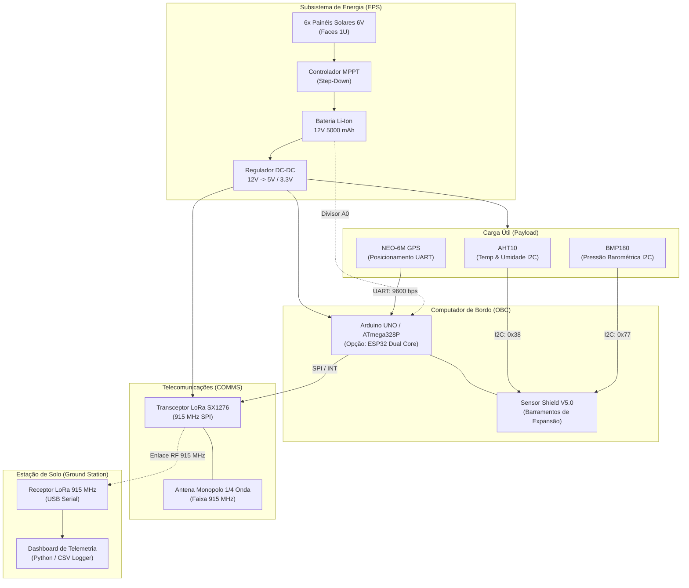

# TupãSat — Kit de CubeSat 1U para Fins Acadêmicos

[](https://opensource.org/licenses/MIT)
[-blue.svg)](https://www.cubesat.org/)
[]()
[](https://doi.org/10.54033/cadpedv22n10-248)
[]()

> **O TupãSat é uma plataforma de nanossatélite modular no padrão CubeSat 1U (10×10×10 cm), de código aberto e baixo custo, desenvolvida para capacitar estudantes e pesquisadores em engenharia aeroespacial, automação e sensoriamento remoto por meio de Aprendizagem Baseada em Problemas (*Problem-Based Learning* - PBL).**

---

## 📖 Artigo de Referência Científica

Este projeto consolida e disponibiliza os códigos, arquivos de fabricação e arquitetura de engenharia descritos na publicação:

* **Título:** *Desenvolvimento de um kit de CubeSat para fins acadêmicos: projeto, construção e aplicações*
* **Autor:** Dafnhê Thor Castro de Martins Barros
* **Periódico:** *Revista Caderno Pedagógico*, Curitiba, v. 22, n. 10, p. 01-19, 2025.
* **DOI:** [10.54033/cadpedv22n10-248](https://doi.org/10.54033/cadpedv22n10-248)
* **Texto Completo:** [OJS Caderno Pedagógico](https://ojs.studiespublicacoes.com.br/ojs/index.php/cadped/article/view/19367)

---

## 🛰️ Visão Geral e Especificações do TupãSat

O satélite atende às diretrizes do padrão internacional CubeSat 1U com foco em facilidade de montagem didática e acessibilidade orçamentária:

| Parâmetro | Especificação TupãSat | Limite Regulamentar 1U |
| :--- | :--- | :--- |
| **Dimensões Físicas** | $100.0 \times 100.0 \times 100.0 \text{ mm}$ (1 Litro) | $100 \times 100 \times 100 \text{ mm} \pm 0.5 \text{ mm}$ |
| **Massa Total Integrada** | **$\approx 822 \text{ g}$** | $\le 1000 \text{ g}$ ($1.33 \text{ kg}$ em revisões CDS) |
| **Custo Total de Materiais** | **$\approx \text{R\$} 810,00$** | $< \text{R\$} 5.000,00$ (kits comerciais) |
| **Estrutura Mecânica (STR)** | Chassi modular impresso em 3D (PLA / PETG) | Trilhos e batentes compatíveis P-POD |
| **Computador de Bordo (OBC)** | Arduino UNO (ATmega328P) + Sensor Shield V5 | Arquitetura expansível (ESP32 / RP2040) |
| **Comunicação (COMMS)** | Transceptor LoRa SX1276 em 915 MHz (UHF) | Faixa ISM autorizada |
| **Sistema de Energia (EPS)** | 6 painéis solares 6V (2.16W pico) + Bat. 12V 5Ah + MPPT | Balanço autônomo com MPPT |
| **Carga Útil (Payload)** | Sensores AHT10 (Temp/Hum), BMP180 (Pressão/Alt) e GPS | Barramento I2C livre para expansões |

---

## 🏗️ Arquitetura dos Subsistemas



---

## 📋 Lista Consolidada de Materiais (BOM)

Baseada na Tabela 1 do artigo de referência (valores de cotação de mercado):

| Item | Qtd | Subsistema | Descrição do Componente | Potência | Custo (R$) | Peso (g) |
| :---: | :---: | :---: | :--- | :---: | :---: | :---: |
| **1** | 1 | OBC | Placa Arduino UNO R3 (Microcontrolador ATmega328P) | 600 mW | R$ 50,00 | 58 g |
| **2** | 1 | OBC | Sensor Shield V5.0 para Arduino | 240 mW | R$ 15,00 | 26 g |
| **3** | 1 | Payload | Sensor de Temperatura e Umidade de Alta Precisão AHT10 | 70 mW | R$ 15,00 | 13 g |
| **4** | 1 | Payload | Sensor de Pressão Barométrica e Temperatura BMP180 | 50 mW | R$ 15,00 | 12 g |
| **5** | 1 | Payload | Módulo de Localização Global GNSS/GPS (NEO-6M) | 250 mW | R$ 55,00 | 25 g |
| **6** | 1 | COMMS | Módulo RF LoRa SX1276 915 MHz + Antena com alcance até 4 km | 300 mW | R$ 65,00 | 25 g |
| **7** | 6 | EPS | Painéis solares fotovoltaicos 6V (uma face por lado) | -2160 mW | R$ 125,00 | 138 g |
| **8** | 1 | EPS | Bateria de Íon de Lítio 12V 5000 mAh com placa BMS | - | R$ 120,00 | 200 g |
| **9** | 1 | EPS | Módulo Controlador de Carga Solar com algoritmo MPPT | - | R$ 50,00 | 200 g |
| **10**| 1 | STR | Chassi 1U modular impresso em 3D (PLA / PETG) | - | R$ 200,00 | 200 g |
| **11**| 1 | STR | Kit de montagem (parafusos M3, porcas nyloc, cabos e conectores)| - | R$ 100,00 | 150 g |
| **TOT**| - | - | **Totais Estimados** | - | **R$ 810,00** | **822 g** |

---

## 📡 Protocolo de Telemetria LoRa

A telemetria padrão é transmitida a cada 5 segundos (ou 60 segundos em modo de economia *Safe Mode*), utilizando sentenças NMEA estendidas com validação por código de redundância cíclica (**CRC16-CCITT**):

```text
$TUPA,<PKT_ID>,<UPTIME_S>,<STATUS>,<V_BAT>,<T_AHT>,<HUM_AHT>,<T_BMP>,<PRESS_HPA>,<ALT_M>,<GPS_FIX>,<LAT>,<LON>,<SATS>*<CRC16>
```

**Exemplo real:**
```text
$TUPA,142,710,0,11.85,24.50,58.2,24.30,1013.2,15.4,1,-20.27410,-40.30650,7*8C2F
```

Consulte o documento completo em [`docs/protocolo_telemetria.md`](docs/protocolo_telemetria.md).

---

## 🚀 Guia Rápido de Instalação e Uso

### 1. Gravação do Firmware da OBC (Arduino UNO)
1. Instale a [Arduino IDE](https://www.arduino.cc/en/software).
2. Instale as bibliotecas necessárias pelo Gerenciador de Bibliotecas da IDE:
   * `LoRa` (por Sandeep Mistry)
   * `Adafruit BMP085 / BMP180 Library`
3. Abra o arquivo [`firmware/tupasat_obc_arduino/tupasat_obc_arduino.ino`](firmware/tupasat_obc_arduino/tupasat_obc_arduino.ino).
4. Selecione a placa **Arduino Uno** e a respectiva porta serial COM.
5. Clique em **Upload**.

### 2. Estação Terrena e Dashboard de Telemetria
1. Grave o código do receptor em [`ground_station/firmware_receptor_lora/firmware_receptor_lora.ino`](ground_station/firmware_receptor_lora/firmware_receptor_lora.ino) em outro Arduino/ESP32 com rádio LoRa.
2. No seu computador, entre na pasta do dashboard e instale as dependências:
   ```bash
   cd ground_station/telemetry_dashboard
   pip install -r requirements.txt
   ```
3. Para executar conectado ao receptor físico:
   ```bash
   python dashboard.py --port COM3 --baud 115200
   ```
4. **Modo de Demonstração / Sala de Aula (Sem Hardware Conectado):**
   ```bash
   python dashboard.py --demo
   ```
   *Irá simular pacotes orbitais com cálculo de CRC16, gráficos de telemetria no console e gravação de log em `tupasat_mission_log.csv`.*

---

## 📂 Organização do Repositório

```text
TupaSat/
├── README.md                                  # Este arquivo de apresentação e especificações
├── LICENSE                                    # Licença MIT
├── citation.cff                               # Metadados de citação acadêmica
├── docs/                                      # Documentação formal de engenharia
│   ├── especificacao_tecnica_tupasat.md       # Requisitos de sistemas e subsistemas (ECSS)
│   ├── conops.md                              # Concept of Operations (modos de operação)
│   ├── protocolo_telemetria.md                # Estrutura de pacotes LoRa 915 MHz e CRC16
│   ├── guia_montagem_mecanica_e_eletrica.md   # Passo a passo pedagógico de integração física
│   └── procedimentos_de_teste.md              # Roteiros de testes e validação em solo
├── hardware/                                  # Projetos de hardware e mecânica
│   ├── bom/
│   │   ├── lista_de_materiais.csv             # Lista de materiais com custos, pesos e potências
│   │   └── pinout_conexoes.md                 # Mapeamento elétrico dos barramentos (I2C/SPI/UART/ADC)
│   └── mecanica_3d/
│       └── README.md                          # Diretrizes e parâmetros de impressão 3D (PLA/PETG)
├── firmware/                                  # Softwares embarcados na OBC
│   ├── tupasat_obc_arduino/                   # Firmware padrão para Arduino UNO + Shield
│   │   ├── tupasat_obc_arduino.ino
│   │   └── config.h
│   └── tupasat_obc_esp32/                     # Firmware avançado dual-core FreeRTOS para ESP32
│       └── tupasat_obc_esp32.ino
└── ground_station/                            # Segmento de solo (estação terrena)
    ├── firmware_receptor_lora/                # Firmware do gateway receptor LoRa USB
    │   └── firmware_receptor_lora.ino
    └── telemetry_dashboard/                   # Aplicação de recepção e análise em tempo real
        ├── dashboard.py
        └── requirements.txt
```

---

## 📜 Licença e Citação

Este projeto é disponibilizado sob a licença **MIT** — incentivando livremente a reprodução, aprimoramento e uso por escolas, universidades e centros de pesquisa.

Caso utilize o TupãSat em suas pesquisas, artigos ou projetos pedagógicos, cite:

```bibtex
@article{barros2025tupasat,
  author    = {Barros, Dafnh{\^e} Thor Castro de Martins},
  title     = {Desenvolvimento de um kit de CubeSat para fins acad{\^e}micos: projeto, constru{\c{c}}{\~a}o e aplica{\c{c}}{\~o}es},
  journal   = {Caderno Pedag{\'o}gico},
  volume    = {22},
  number    = {10},
  pages     = {1--19},
  year      = {2025},
  issn      = {1983-0882},
  doi       = {10.54033/cadpedv22n10-248},
  url       = {https://ojs.studiespublicacoes.com.br/ojs/index.php/cadped/article/view/19367}
}
```
