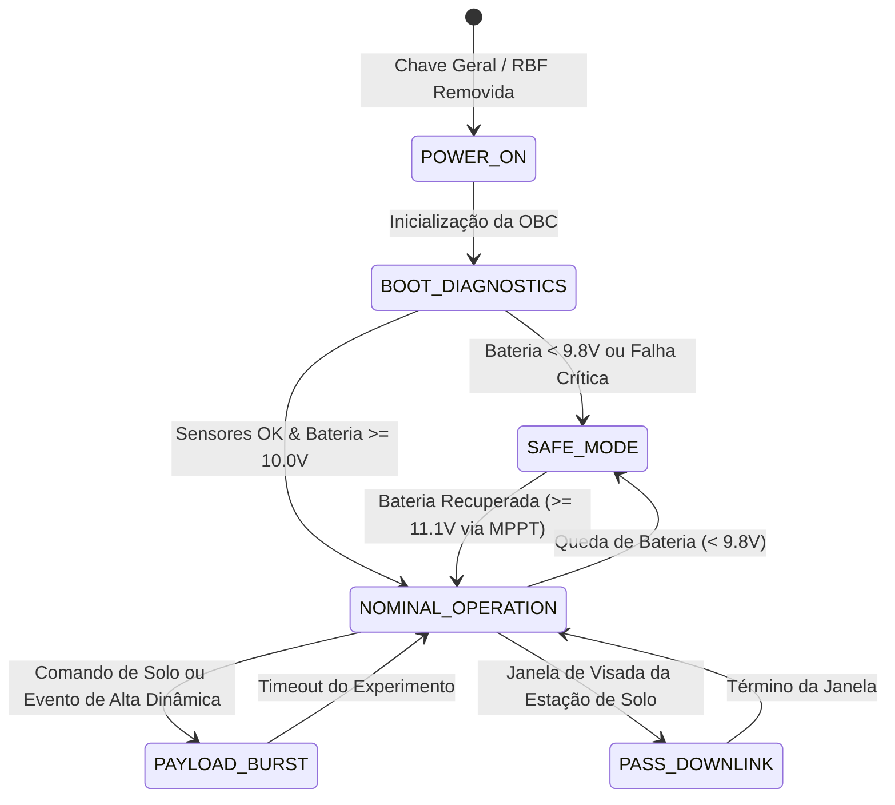

# Conceito de Operações (CONOPS) — TupãSat 1U

O **CONOPS (*Concept of Operations*)** descreve a lógica operacional, os modos de voo, a máquina de estados finitos (FSM) e o comportamento do **TupãSat** durante todo o seu ciclo de vida em solo, testes em campo e eventuais missões suborbitais ou em balões estratosféricos.

---

## 1. Diagrama da Máquina de Estados Operacionais

---

## 2. Descrição Detalhada dos Modos de Operação

### 2.1. Modo 0: Desligado / Standby Pré-Lançamento (*Off / RBF Active*)
* **Condição:** Chave mecânica de segurança *Remove Before Flight* (RBF) inserida.
* **Comportamento:** Bateria desconectada dos barramentos principais. O MPPT pode carregar a bateria via painéis solares externos, mas a OBC e o rádio permanecem sem energia.

### 2.2. Modo 1: Inicialização e Autodiagnóstico (*Boot & Self-Test*)
* **Duração:** 3 a 5 segundos após religar a alimentação.
* **Rotinas:**
  1. Inicialização do barramento I2C e verificação de resposta dos endereços `0x38` (AHT10) e `0x77` (BMP180).
  2. Inicialização da interface SPI e configuração dos registradores do transceptor LoRa SX1276 (915 MHz, Bandwidth 125 kHz, Spreading Factor 7, Coding Rate 4/5).
  3. Leitura da tensão da bateria no canal analógico A0.
  4. Envio de pacote inicial de *Beacon de Boas-Vindas / Boot Diagnostic* pela interface de rádio e pela porta serial de debug.

### 2.3. Modo 2: Operação Nominal (*Nominal Beacon Mode*)
* **Condição:** Tensão da bateria $\ge 10.0\text{ V}$.
* **Ciclo de Trabalho (*Duty Cycle*):**
  * Período de amostragem e transmissão: a cada 5 segundos.
  * Aquisição de temperatura, umidade, pressão barométrica, altitude calculada e dados de geolocalização GNSS (fix, satélites visíveis, latitude, longitude).
  * Empacotamento com CRC16 e transmissão via LoRa.
  * O rádio entra em modo *Sleep/Standby* no intervalo entre transmissões para poupar energia térmica e elétrica.

### 2.4. Modo 3: Modo de Segurança e Economia (*Safe Mode*)
* **Condição:** Tensão da bateria $< 9.8\text{ V}$ (risco de sobredescarga da bateria de 3 células).
* **Ações de Mitigação:**
  * Desativação do receptor GPS (alto consumidor de corrente).
  * Aumento do intervalo de transmissão de telemetria de 5s para 60s (*Heartbeat* lento).
  * Envio de bandeira de alerta `STATUS_CRITICAL_BATTERY` no cabeçalho do pacote.
  * Foco prioritário na recarga via subsistema solar fotovoltaico até a recuperação da histerese ($V_{\text{bat}} \ge 11.1\text{ V}$).

### 2.5. Modo 4: Experimento / Alta Taxa de Amostragem (*Payload Burst*)
* **Gatilho:** Execução de testes de queda, subida em balão ou dinâmica rápida de altitude.
* **Comportamento:** A taxa de amostragem e envio sobe para 1 segundo (ou envio contínuo na capacidade máxima do LoRa).
* **Proteção:** Temporizador de segurança desativa o modo Burst após 10 minutos para evitar aquecimento excessivo do estágio de RF ou esgotamento da bateria.

---

## 3. Estratégia de Tolerância a Falhas
* **Sensor Offline:** Se o sensor AHT10 ou BMP180 parar de responder no barramento I2C, a OBC não trava: preenche os campos respectivos com valores sentinela (`-999.0`) e continua transmitindo as demais variáveis e o status do satélite.
* **Perda de Sinal GNSS:** Se o GPS perder fixação (ex.: dentro de ambientes fechados em sala de aula), o pacote reporta `GPS_FIX = 0`, mantendo as leituras barométricas e ambientais ativas.
* **Watchdog Timer:** O microcontrolador reinicializa automaticamente caso o ciclo de transmissão trave por mais de 8 segundos.
