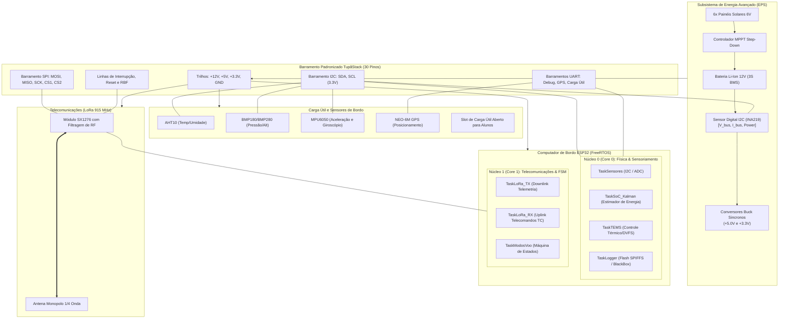

# Especificação da Evolução Arquitetural — TupãSat v2.0

Este documento formaliza o plano de evolução do **TupãSat**, elevando a plataforma de um kit de bancada básico (baseado em Arduino UNO e cabos *jumpers*) para uma **arquitetura de nível de engenharia e pesquisa (Nível TRL 4 a 6)**, integrando processamento multitarefa, sensoriamento digital avançado de potência, determinação de atitude (ADCS) e telecomando bidirecional (TM/TC).

---

## 1. Matriz de Evolução Arquitetural (v1.0 vs v2.0)

| Subsistema | Versão 1.0 (Prova de Conceito / Artigo) | Versão 2.0 (Evolução Avançada / Pesquisa) |
| :--- | :--- | :--- |
| **Computador de Bordo (OBC)** | Arduino UNO (ATmega328P, 8-bit, 16 MHz, loop sequencial síncrono). | **ESP32 Dual-Core (Xtensa LX6, 32-bit, 240 MHz, FreeRTOS preempitivo)** com separação de núcleos para RF e Telemetria. |
| **Arquitetura de Barramento** | Sensor Shield V5.0 com cabeamento avulso (*jumpers*). | **Barramento Empilhável "TupãStack"** (conector padronizado de 30 pinos), eliminando 100% dos fios soltos. |
| **Sensoriamento de Potência (EPS)** | Divisor resistivo analógico passivo (apenas tensão estimada da bateria). | **Sensor Digital I2C de Alta Precisão (INA219 / INA226)** medindo tensão de barramento ($V$), corrente instantânea ($I$) e potência ($P$). |
| **Estimativa de Bateria (SoC)** | Curva estática de tensão ($V \times \text{SoC}$). | **Estimador Dinâmico de Estado de Carga (SoC)** combinando *Coulomb Counting* e **Filtro de Kalman Adaptativo (AEKF)**. |
| **Controle Térmico-Energético (TEMS)** | Limiar estático de Safe Mode ($V < 9.8\text{V}$). | **Gerenciamento Térmico-Energético Ativo**: modulação dinâmica de frequência da CPU (DVFS) e *duty cycle* do rádio baseados em temperatura e SoC. |
| **Determinação de Atitude (ADCS)** | Não existente na v1.0. | **IMU 6-DOF / 9-DOF (MPU6050 / BNO055)** fornecendo aceleração linear, velocidade angular e ângulos de Euler (Roll, Pitch, Yaw). |
| **Comunicação (COMMS)** | Telemetria unidirecional (*downlink* de beacon sem confirmação). | **Protocolo Bidirecional de Telemetria e Telecomando (TM/TC)** com confirmação de recebimento (ACK) e comandos remotos. |
| **Armazenamento de Dados** | Apenas transmissão volátil instantânea. | **Gravador de Dados de Missão (*BlackBox*)** em memória flash não-volátil (SPIFFS / LittleFS / cartão micro-SD). |
| **Estação Terrena (Ground Station)** | Terminal de console em modo texto. | **Painel Web Interativo (Streamlit / Plotly)** com gráficos de telemetria em tempo real, mapa de rota GPS e console de envio de comandos. |

---

## 2. Diagrama de Blocos da Arquitetura TupãSat v2.0

---

## 3. Protocolo de Telecomandos de Solo (Uplink TC)

Na versão 2.0, a estação terrena pode enviar comandos para o TupãSat. Todos os telecomandos utilizam a palavra de cabeçalho `!TUPA_CMD` seguida do código do comando, parâmetros e CRC16:

| Código | Comando | Parâmetros | Descrição / Ação do Satélite |
| :--- | :--- | :--- | :--- |
| **`CMD_PING`** | `0x01` | Nenhum | Responde imediatamente com pacote de `ACK_PONG` e nível de RSSI. |
| **`CMD_SET_RATE`**| `0x02` | `interval_ms` (16-bit) | Altera dinamicamente a taxa de amostragem e envio de telemetria. |
| **`CMD_SAFE_MODE`**| `0x03` | `0` (Sair) ou `1` (Entrar)| Força a entrada ou saída manual do Modo de Segurança (*Safe Mode*). |
| **`CMD_BURST`** | `0x04` | `duration_sec` (16-bit)| Inicia transmissão de alta taxa de dados (ex.: durante manobra de queda/lançamento). |
| **`CMD_DUMP_LOG`**| `0x05` | `start_pkt`, `count` | Despeja dados gravados na memória flash durante períodos sem visada da estação. |
| **`CMD_REBOOT`** | `0xFF` | `0xA55A` (Chave de segurança)| Executa *soft reboot* do microcontrolador da OBC. |

---

## 4. Integração do Gerenciamento Térmico-Energético (TEMS)

A versão 2.0 conecta diretamente a engenharia prática do TupãSat com a pesquisa de mestrado do IFES (*Modelagem Computacional de Gerenciamento Térmico-Energético para Data Centers Orbitais*):

1. **Estimativa de SoC com Filtro de Kalman Adaptativo (AEKF):**
   * Em vez de depender puramente da tensão (que varia bruscamente sob carga), o modelo calcula a integral da corrente lida pelo INA219 combinada recursivamente com a equação de circuito equivalente de bateria (Thevenin de 1ª ordem), gerando estimativas de SoC confiáveis em tempo real.
2. **Dynamic Voltage & Frequency Scaling (DVFS) em Órbita:**
   * Caso a temperatura do processador ou do rádio atinja limites térmicos superiores ($T > 65^\circ\text{C}$) ou o SoC caia abaixo de $25\%$, a OBC reduz a frequência de clock do ESP32 de $240\text{ MHz}$ para $80\text{ MHz}$ ou $40\text{ MHz}$, reduzindo o consumo de energia e a dissipação de calor em até $70\%$.
